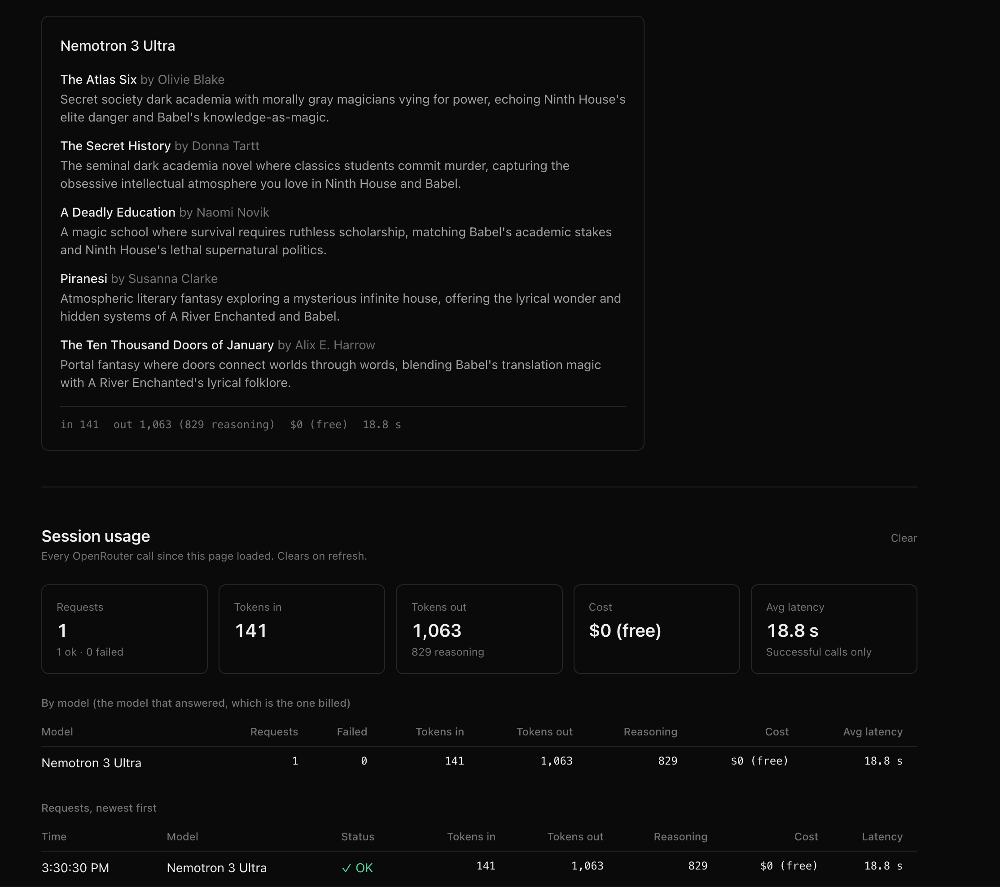
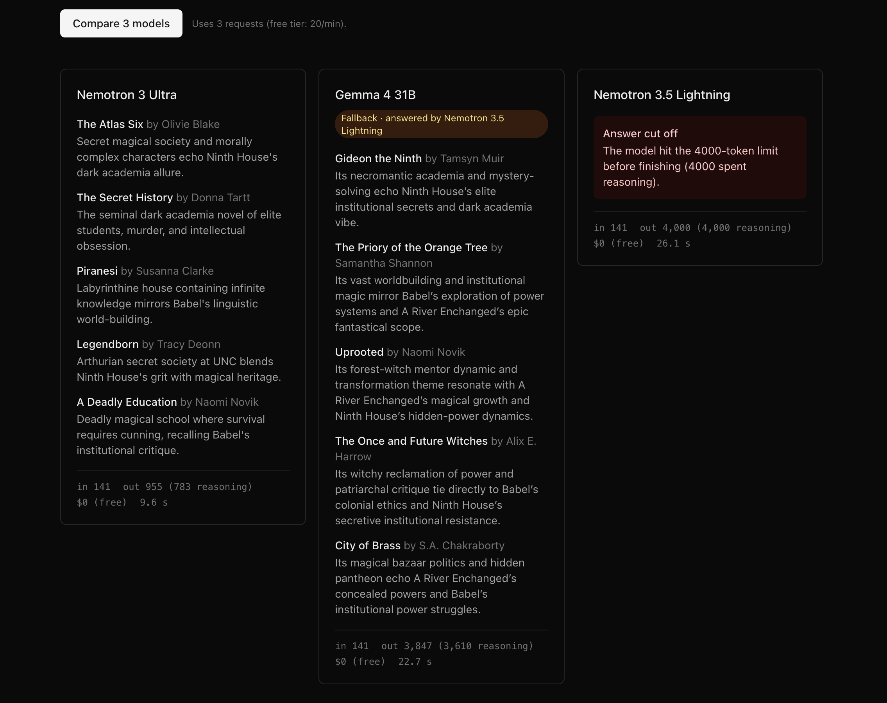
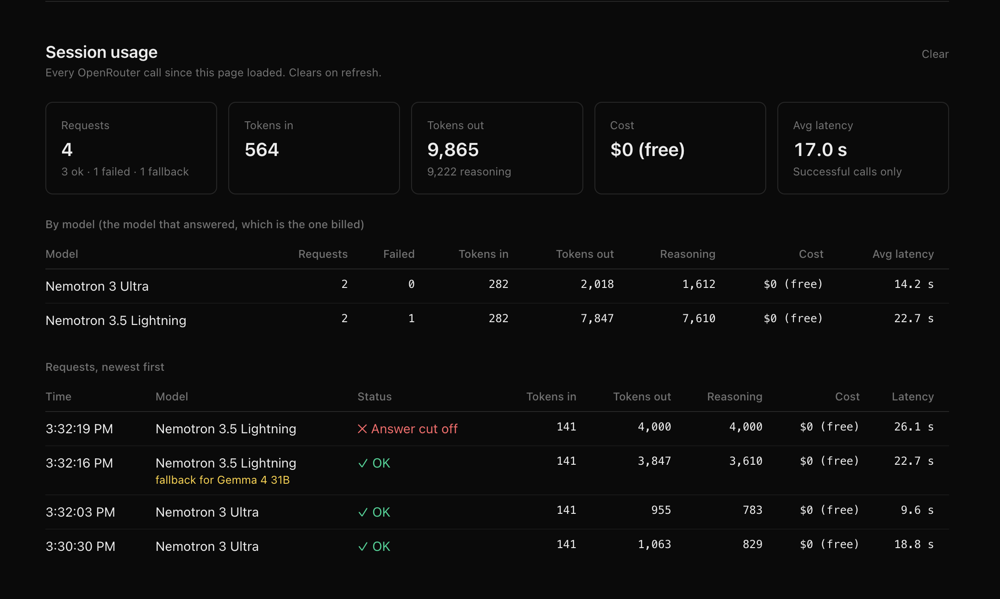
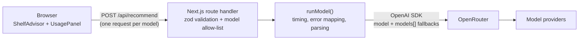

# Shelf Advisor

AI book recommendations, compared across models, with token, cost, and latency visibility for every request.

**Live demo:** [shelf-advisor.vercel.app](https://shelf-advisor.vercel.app)

Built on the [OpenRouter](https://openrouter.ai) API with Next.js and TypeScript.





## What it does

- **Recommendations:** enter 3–5 books you loved (and optionally some you didn't) and get 5 picks, each with a one-line reason.
- **Compare mode:** send the same prompt with the same settings to 2–3 models side by side. Each card fills in as its model finishes, so speed differences are visible.
- **Fallbacks:** each request carries a fallback chain. If a model is rate limited, down, or refuses, OpenRouter tries the next one, and the UI shows which model actually answered.
- **Usage visibility:** every call shows tokens in/out (including hidden reasoning tokens), cost, and latency. A session panel totals them, broken down by model and by request.
- **Failure states:** loading with elapsed time, cancel, typed error messages, and a countdown after a rate limit.

## Architecture



The API key lives only in server environment variables. `src/lib/env.ts` imports `server-only`, so the build fails if client code ever imports it.

| Path | Purpose |
|---|---|
| `src/config/models.ts` | **The one file to edit for models:** picker list, fallback chain, generation settings |
| `src/app/api/recommend/route.ts` | Validates input, allows only configured models, runs them in parallel |
| `src/lib/recommend.ts` | Calls OpenRouter, measures latency, maps errors, reads usage and the responding model |
| `src/lib/prompt.ts` | JSON-only prompt and a tolerant parser validated with zod |
| `src/lib/usage.ts` | Pure aggregation for session totals and per-model breakdowns |
| `src/components/` | Form, model picker, result cards, usage panel |

### Key decisions

- **OpenRouter's `models` array for fallbacks.** The primary goes in `model` and fallbacks in `models`. OpenRouter handles failover server-side, so the app makes one HTTP call per model. The response's `model` field shows which model answered.
- **SDK retries off.** The OpenAI SDK retries 429/5xx twice by default. That would hide failures, inflate latency, and burn free-tier quota, so retries are left to OpenRouter's fallbacks.
- **Model allow-list.** The route only accepts model IDs from config, so nobody can spend the key on an arbitrary model by editing the request.
- **Reasoning budget.** Reasoning tokens count against `max_tokens`. The first version used up the whole budget thinking and returned no answer. The fix is a larger budget plus `reasoning.effort: "low"`, and cut-off answers (`finish_reason: "length"`) are reported as their own error.
- **Usage accounting choices.**
  - Fallback calls are attributed to the model that answered, which is the one billed.
  - Tokens from failed-but-billed calls (truncated or unparseable output) still count.
  - Average latency uses successful calls only, so fast-failing 429s don't make a model look quick.
- **One request per model in compare mode.** A slow reasoning model doesn't hold back a fast one.
- **No database or auth in v1.** Usage is session state in React and clears on refresh.

## Run locally

Requires Node.js 20+ and an [OpenRouter API key](https://openrouter.ai/keys).

```bash
git clone https://github.com/triciahughes/shelf-advisor.git
cd shelf-advisor
npm install
cp .env.example .env.local   # then add your OPENROUTER_API_KEY
npm run dev                  # http://localhost:3000
```

| Variable | Required | Purpose |
|---|---|---|
| `OPENROUTER_API_KEY` | Yes | Server-side only. Never prefix with `NEXT_PUBLIC_`. |
| `SITE_URL` | No | Sent as `HTTP-Referer` for OpenRouter app attribution |
| `APP_TITLE` | No | Sent as `X-OpenRouter-Title` |

### Changing models

Edit `src/config/models.ts`. During development every entry is a `:free` variant. Free variants change often, so if a slug stops working, pick a current one from [openrouter.ai/models](https://openrouter.ai/models).

Requests are billed at the model that actually answered, so a paid model anywhere in the fallback chain can cost money. Free models have per-minute and daily request limits; see OpenRouter's [rate limits](https://openrouter.ai/docs/api_reference/limits.md).

### Deploy

Import the repo into Vercel and set `OPENROUTER_API_KEY`, plus `SITE_URL` with the production URL. For a public demo, use a dedicated key with a low credit limit.

## What I learned comparing models

I compared three free models. Nemotron 3 Ultra was the most consistent, both in token usage and in reliably returning a result. Gemma 4 31B came second. It recommended the same book across sessions, but I was mostly rotating my same favorite books as input, so I’m not sure that consistency is a flaw. Nemotron 3.5 Lightning often hit token usage limits and only returned output twice across several runs. Since all three are free, Lightning is the only one I’d really fault.

## Possible next steps

- Persist usage history so totals survive a refresh
- Per-IP rate limiting on the public demo
- Streaming responses
